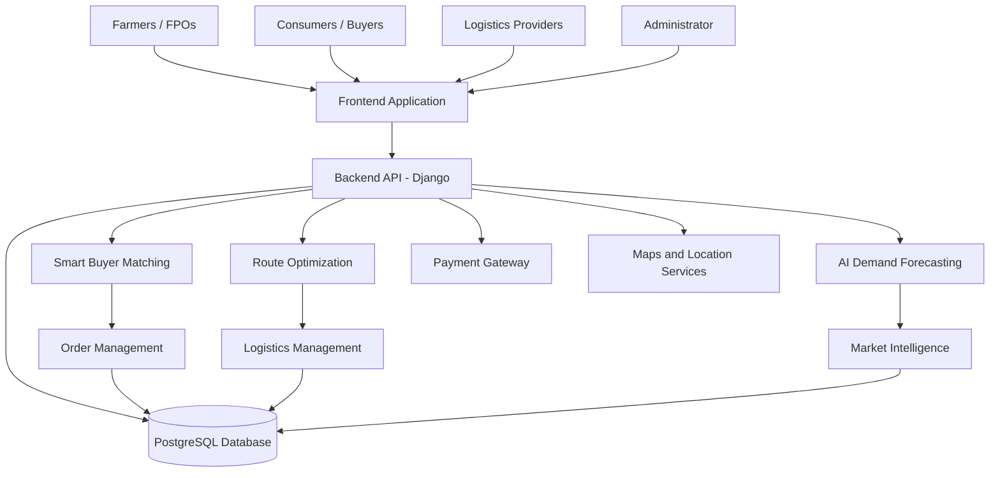
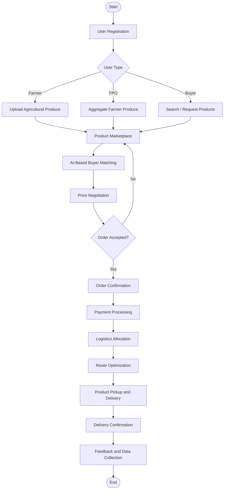

# 🌾 KisanSetu – Direct Farm-to-Market Digital Platform

**Smart India Hackathon 2026 – Problem ID: SIH 26033**

**Tagline:** From Farmers to Consumers – Fair Prices, Zero Unnecessary Intermediaries.

---

# Smart India Hackathon Workshop

**Date:** 24 November 2026

**Reference Number:** SIH 26033

**Name:** Chamunda S

## Problem Title

**SIH 26033: Multiple Intermediaries Reduce Farmers' Earnings and Increase Consumer Prices.**

## Problem Creator's Organization

Ministry of Consumer Affairs, Food & Public Distribution

## Theme

Agriculture, FoodTech & Rural Development

## Problem Description

Agricultural supply chains in India often involve multiple intermediaries between farmers and final consumers. These intermediaries increase the overall cost of agricultural products while reducing the share of the final selling price received by farmers.

Small and marginal farmers frequently lack direct access to large markets, retailers, wholesalers and institutional buyers. They may also face difficulties in transportation, storage, price discovery and identifying genuine buyers.

The expected solution is to develop a digital marketplace that:

- Connects farmers and Farmer Producer Organizations (FPOs) directly with consumers and bulk buyers.
- Provides transportation and logistics support.
- Uses Artificial Intelligence (AI) for demand forecasting and route optimization.

**Expected Benefits:**

- Better prices and increased earnings for farmers.
- Affordable agricultural products for consumers.
- Reduced supply chain inefficiencies.
- Improved transparency in agricultural trading.

---

# Proposed Solution

## 1. KisanSetu – A Unified Digital Agricultural Marketplace

KisanSetu is a digital agricultural marketplace designed to establish a direct connection between farmers, FPOs, retailers, wholesalers, restaurants, supermarkets, institutional buyers and individual consumers.

The platform reduces unnecessary intermediaries by allowing farmers to list their agricultural produce directly and receive orders from potential buyers.

It combines digital trading, intelligent demand forecasting, collective procurement and optimized logistics into a single platform.

### A. Direct Farmer-to-Consumer Marketplace

Farmers can register on the platform and upload their agricultural products with the following information:

- Product name and category.
- Available quantity.
- Product images.
- Harvest date.
- Location of the farm.
- Expected selling price.
- Quality and grading information.
- Availability and delivery details.

Consumers can browse available products, compare prices, select quantities and place orders directly with farmers.

The platform displays transparent pricing so that both parties understand the transaction.

### B. FPO-Based Agricultural Aggregation

Small farmers often produce quantities that are insufficient to attract large institutional buyers.

KisanSetu solves this problem through Farmer Producer Organizations (FPOs).

Multiple farmers can combine their agricultural produce through an FPO to create larger marketable quantities.

For example:

- Farmer A supplies 100 kg of tomatoes.
- Farmer B supplies 150 kg of tomatoes.
- Farmer C supplies 250 kg of tomatoes.

The FPO aggregates these quantities into a single 500 kg inventory.

This enables bulk buyers, supermarkets, restaurants and wholesalers to purchase directly from the farmer collective.

### C. Smart Buyer-Farmer Matching

The platform automatically recommends suitable buyers for available agricultural products.

The matching system considers:

- Product category.
- Available quantity.
- Buyer requirements.
- Geographical distance.
- Expected delivery date.
- Product quality.
- Price expectations.

Farmers receive notifications when buyers are interested in their produce.

Buyers can submit purchase requests, while farmers can accept, reject or negotiate offers.

### D. AI-Based Demand Forecasting

KisanSetu uses Machine Learning to estimate future demand for agricultural products.

The forecasting model considers:

- Historical sales data.
- Seasonal demand patterns.
- Previous purchase records.
- Local market demand.
- Weather information, when available.
- Festival and seasonal consumption patterns.

The system predicts the approximate quantity of agricultural products likely to be required in a particular region.

**Example:**

If historical data indicates increased demand for tomatoes during a particular period, the platform can inform farmers and FPOs about the expected demand.

Farmers can use this information to plan harvesting, inventory and selling decisions.

The system will initially use historical averages and rule-based forecasting when data is limited. More advanced machine learning models will be introduced as sufficient transaction data becomes available.

### E. Smart Logistics and Route Optimization

Transportation is an important component of agricultural supply chains.

KisanSetu provides a logistics coordination system that connects farmers and FPOs with available transport providers.

The platform can:

- Identify nearby transportation providers.
- Calculate approximate delivery distances.
- Combine orders going to similar locations.
- Recommend suitable vehicles based on quantity.
- Generate optimized delivery routes.
- Track shipment status.
- Notify buyers about expected delivery times.

A route optimization algorithm minimizes unnecessary travel distance, transportation costs and delivery delays.

For perishable products, the system also considers delivery time and available cold-chain facilities.

### F. Transparent Digital Payments

The platform provides secure digital payment integration through authorized payment service providers.

Features include:

- Online payment through UPI and other supported methods.
- Digital invoices.
- Order payment status.
- Transaction history.
- Farmer payment records.
- Buyer order history.

Payment settlement arrangements will be designed with authorized payment partners so that farmers receive their payments transparently.

### G. Multilingual and Farmer-Friendly Interface

To make the platform accessible to farmers from different regions, KisanSetu will support multiple Indian languages.

Initial languages:

- Tamil
- English
- Hindi

The interface will include:

- Simple navigation.
- Mobile-friendly screens.
- Voice-assisted product listing.
- Clear instructions.
- Notifications.
- Low-bandwidth support.

Farmers who are unfamiliar with digital applications should be able to use the platform with minimal technical knowledge.

### How KisanSetu Addresses the Problem

| Existing Problem | Proposed Solution |
|---|---|
| Multiple intermediaries | Direct farmer-to-buyer connections |
| Low earnings for farmers | Transparent pricing and improved market access |
| High consumer prices | Reduced unnecessary supply chain costs |
| Difficulty finding buyers | Intelligent buyer-farmer matching |
| Small production quantities | FPO-based product aggregation |
| Transportation difficulties | Integrated logistics coordination |
| Unpredictable demand | AI-based demand forecasting |
| Inefficient delivery routes | Route optimization |
| Limited price information | Market price comparison and analytics |

### Innovation and Uniqueness

The uniqueness of KisanSetu lies in combining several agricultural supply chain operations into one platform.

1. **Collective Selling:** Aggregates products from multiple small farmers to fulfil large orders.
2. **AI-Based Market Intelligence:** Provides demand predictions to help farmers make informed decisions.
3. **Smart Logistics:** Groups nearby orders and recommends optimized delivery routes.
4. **Transparent Price Discovery:** Allows farmers and buyers to compare prices and negotiate.
5. **Direct Market Access:** Connects farmers with consumers, retailers and institutional buyers.
6. **Multilingual Accessibility:** Makes digital agricultural trading accessible to farmers with different language preferences.

Unlike a basic agricultural shopping application, KisanSetu focuses on improving the complete journey from farm-level product availability to final delivery.

---

# Technical Approach

## 2. Technologies to Be Used

The system will be developed using modern web technologies, database management systems, Artificial Intelligence and mapping services.

### A. Frontend Development

| Technology | Purpose |
|---|---|
| HTML5 | Web page structure |
| CSS3 | Styling and responsive layouts |
| JavaScript | Frontend functionality |
| React.js | Interactive user interface |
| Bootstrap / Tailwind CSS | Responsive design |

The frontend will provide separate dashboards for farmers, buyers, FPOs, logistics providers and administrators.

### B. Backend Development

| Technology | Purpose |
|---|---|
| Python | Main programming language |
| Django / Django REST Framework | Backend development and APIs |
| REST API | Communication between frontend and backend |
| JWT / OTP Authentication | User authentication and access control |

Django will manage users, agricultural listings, orders, payments, logistics and platform operations.

### C. Database Management

**PostgreSQL / MySQL**

The database will maintain:

- User information.
- Farmer and FPO details.
- Product listings.
- Agricultural inventory.
- Buyer requirements.
- Orders and transactions.
- Logistics information.
- Delivery status.
- Demand forecasting data.

PostgreSQL with PostGIS can additionally support location-based queries.

### D. Artificial Intelligence and Machine Learning

| Technology | Purpose |
|---|---|
| Python | AI model development |
| Pandas | Data processing |
| NumPy | Numerical calculations |
| Scikit-learn | Machine Learning |
| XGBoost | Demand prediction |
| Google OR-Tools | Logistics route optimization |

Machine Learning models will analyze historical sales and demand patterns to estimate future product requirements.

Google OR-Tools will be used to solve vehicle routing problems while considering delivery locations, vehicle capacity and delivery constraints.

### E. Maps and Logistics

- OpenStreetMap – Geographical information.
- Mapping and routing APIs – Distance and route information.
- Google OR-Tools – Route optimization.
- GPS integration – Vehicle location tracking, where supported.

### F. Other Technologies

- Git and GitHub – Version control.
- Postman – API testing.
- Figma – UI/UX design.
- Cloud hosting – Application deployment.
- Payment gateway – Secure digital payments.
- SMS/notification service – Order updates.

---

## 3. System Architecture

The proposed system consists of five major components:

1. User Interface Layer
2. Application and API Layer
3. Database Layer
4. AI and Optimization Layer
5. External Services and Integration Layer

### System Architecture Diagram

### 4. Working Process of the Platform

**Step 1 – User Registration**

Farmers, buyers, FPOs and logistics providers register on the platform.

**Step 2 – Product Listing**

Farmers upload their available agricultural products, quantity, quality, location and expected prices.

**Step 3 – Product Aggregation**

Small farmers can combine their produce through registered FPOs to fulfil larger buyer requirements.

**Step 4 – Buyer Discovery**

Consumers and bulk buyers search for available products and submit purchase requests.

**Step 5 – Intelligent Matching**

The platform recommends suitable farmers and FPOs based on product availability, location, quantity and price.

**Step 6 – Order Confirmation**

Buyers and farmers agree on the price and delivery conditions. Once confirmed, an order is generated.

**Step 7 – Logistics Allocation**

The system identifies suitable transportation options and calculates efficient delivery routes.

**Step 8 – Payment Processing**

Buyers complete payment using supported digital payment methods.

**Step 9 – Product Delivery**

The logistics provider collects the agricultural products and delivers them to the buyer.

**Step 10 – Order Completion and Feedback**

The buyer confirms delivery and provides feedback. The transaction is stored for future analytics and demand forecasting.

### Workflow Diagram

---

## 5. Main Application Modules

| Module | Main Functions |
|---|---|
| Farmer Module | Registration, product listing, inventory and orders |
| Consumer Module | Product browsing, ordering and payment |
| FPO Module | Farmer aggregation and bulk inventory |
| Buyer Module | Bulk orders, quotations and purchase management |
| AI Module | Demand prediction and product recommendations |
| Logistics Module | Transport allocation and route optimization |
| Payment Module | Digital transactions and invoices |
| Admin Module | User verification, monitoring and reporting |

---

## 6. Proposed Database Structure

The database will contain the following major tables:

| Table Name | Description |
|---|---|
| Users | User registration and authentication |
| Farmers | Farmer-specific information |
| FPOs | Farmer Producer Organization details |
| Buyers | Consumer and institutional buyer details |
| Products | Agricultural product information |
| Inventory | Available quantities and stock |
| Orders | Purchase orders |
| Order_Items | Products included in each order |
| Payments | Payment transactions |
| Logistics | Transportation provider details |
| Deliveries | Shipment and delivery tracking |
| Forecasts | AI demand prediction results |
| Reviews | Buyer and seller feedback |

---

## 7. Methodology and Implementation Plan

The implementation will be completed in four phases.

**Phase 1 – Basic Marketplace**

- Develop user registration and login.
- Create farmer and buyer dashboards.
- Implement agricultural product listings.
- Develop search and filtering.
- Implement basic order management.

**Phase 2 – FPO and Trading System**

- Develop FPO registration.
- Implement collective inventory management.
- Develop bulk purchasing.
- Implement price negotiation.
- Generate digital invoices.

**Phase 3 – AI and Logistics Integration**

- Collect historical transaction data.
- Implement demand forecasting.
- Integrate location and mapping services.
- Develop vehicle allocation.
- Implement route optimization.

**Phase 4 – Testing and Deployment**

- Conduct functional testing.
- Test the complete order process.
- Test AI predictions using available datasets.
- Test route optimization.
- Evaluate performance and security.
- Deploy the application on a cloud server.

### Proposed Prototype Features

For the initial Smart India Hackathon prototype, the following features will be demonstrated:

1. Farmer registration and login.
2. Product listing and inventory management.
3. Buyer registration and product browsing.
4. Direct ordering system.
5. FPO-based product aggregation.
6. Basic demand forecasting dashboard.
7. Route optimization demonstration.
8. Order and delivery status tracking.

Advanced payment, live vehicle tracking and external marketplace integrations can be introduced during subsequent development.

---

# Feasibility and Viability

## 8. Analysis of Feasibility

KisanSetu is technically and operationally feasible because it can be developed using existing technologies and commonly available digital infrastructure.

### Technical Feasibility

- The platform can be developed using open-source programming languages and frameworks.
- Cloud-based hosting supports future scalability.
- Existing mapping services can provide geographical information.
- Python libraries support Machine Learning and optimization.
- Relational databases provide reliable storage and transaction management.

### Operational Feasibility

- Farmers can use smartphones to upload their produce.
- FPOs can help farmers who have limited digital knowledge.
- Buyers can access agricultural products from different locations.
- Transport providers can participate through a logistics dashboard.
- Administrators can monitor registrations, transactions and complaints.

### Economic Feasibility

The platform can initially operate with a relatively small infrastructure budget.

Potential revenue sources include:

- Transparent transaction-based service charges.
- Optional subscription plans for institutional buyers.
- Logistics coordination service charges.
- Premium inventory and analytics services.
- FPO and institutional partnership services.

The basic farmer listing and buyer discovery facilities can be offered at low or zero cost to encourage adoption.

The platform should disclose every applicable service charge before an order is confirmed.

---

## 9. Potential Challenges and Risks

| Challenge | Proposed Mitigation |
|---|---|
| Limited digital literacy among farmers | Simple interface, regional languages and FPO assistance |
| Unavailability of sufficient data | Begin with rule-based predictions and gradually train ML models |
| Product quality differences | Quality grading, images and optional verification |
| Transportation costs | Group orders and optimize delivery routes |
| Product wastage | Better demand prediction and faster delivery |
| Fake buyers or sellers | Identity verification and user ratings |
| Payment-related issues | Authorized payment gateways and transaction monitoring |
| Internet connectivity problems | Lightweight, mobile-friendly and offline-capable features |
| Existing market regulations | Follow applicable state agricultural marketing laws and licensing requirements |
| Seasonal price fluctuations | Display market benchmarks and historical trends |

### Strategies for Overcoming Challenges

1. Start with a limited number of farmers, buyers and agricultural commodities.
2. Collaborate with existing FPOs and farmer cooperatives.
3. Provide training and onboarding assistance.
4. Introduce AI features gradually as sufficient data becomes available.
5. Partner with local transport providers.
6. Use transparent pricing and verified transactions.
7. Follow applicable government regulations and agricultural trading requirements.

---

## 10. Scalability and Long-Term Sustainability

KisanSetu will follow a gradual expansion strategy.

**Stage 1 – Local Implementation**

Launch the platform in one agricultural region with a selected group of farmers, FPOs and buyers.

**Stage 2 – District-Level Expansion**

Connect additional FPOs, local retailers, wholesalers and transportation providers.

**Stage 3 – State-Level Expansion**

Expand the platform to different agricultural markets and commodities.

**Stage 4 – National Expansion**

Connect agricultural producers and buyers across different Indian states.

The system can later integrate with suitable government agricultural platforms and digital commerce networks, subject to technical compatibility and required permissions.

---

# Impact and Benefits

## 11. Potential Impact on the Target Audience

### A. Farmers

- Improved access to buyers.
- Better opportunities for price negotiation.
- Reduced dependency on unnecessary intermediaries.
- Access to larger markets.
- Improved inventory and harvesting decisions.
- Better market information.

### B. Consumers

- Access to agricultural products directly from producers.
- Potentially lower purchase prices.
- Better product traceability.
- Greater transparency in pricing.
- Improved product availability.

### C. Farmer Producer Organizations

- Easier aggregation of agricultural produce.
- Access to bulk buyers.
- Improved inventory management.
- Better coordination among member farmers.
- Digital transaction records.

### D. Wholesale and Institutional Buyers

- Access to multiple agricultural suppliers.
- Easier bulk procurement.
- Better product availability information.
- Simplified purchase management.
- More predictable supply planning.

### E. Logistics Providers

- Access to transport requirements.
- Better vehicle utilization.
- Optimized delivery routes.
- Reduced unnecessary travel.
- Improved delivery coordination.

---

## 12. Social, Economic and Environmental Benefits

| Category | Expected Benefits |
|---|---|
| Economic | Better farmer price realization and reduced unnecessary costs |
| Social | Improved market accessibility for small and marginal farmers |
| Consumer | More transparent and competitive pricing |
| Agricultural | Better demand planning and inventory management |
| Environmental | Reduced unnecessary transportation and potential food wastage |
| Technological | Increased adoption of AI and digital commerce in agriculture |

### Key Performance Indicators (KPIs)

The success of KisanSetu will be evaluated through the following measurable indicators:

1. Number of registered farmers.
2. Number of participating FPOs.
3. Number of active buyers.
4. Total agricultural quantity traded.
5. Average farmer net price realization.
6. Difference between farm-gate and consumer prices.
7. Average order fulfilment time.
8. Percentage of successfully completed deliveries.
9. Transportation cost per kilogram.
10. Estimated post-harvest wastage.

A pilot implementation will compare these indicators against the existing local supply chain to measure actual improvements.

---

# Research and References

## 13. Research and Reference Materials

The proposed solution is based on research into existing agricultural marketplaces, FPO development programmes, agricultural infrastructure and digital technologies.

### 1. National Agriculture Market (e-NAM)

**Website:** https://www.enam.gov.in/

e-NAM is an electronic agricultural trading platform that connects agricultural markets and provides facilities for transparent trading, price discovery, assaying and digital payments.

**Relevance to KisanSetu:** Provides a reference for electronic agricultural trading and market transparency.

### 2. Formation and Promotion of 10,000 FPOs

**Reference:** https://sfacindia.com/

The Government of India supports Farmer Producer Organizations to improve collective farming activities, aggregation and market linkages.

**Relevance to KisanSetu:** Supports the proposed FPO-based aggregation and collective selling module.

### 3. Agriculture Infrastructure Fund (AIF)

**Website:** https://agriinfra.dac.gov.in/

The Agriculture Infrastructure Fund supports the development of agricultural infrastructure, including warehouses, cold storage, sorting, grading, packaging and logistics facilities.

**Relevance to KisanSetu:** Provides a reference for improving post-harvest infrastructure and agricultural logistics.

### 4. OpenStreetMap

**Website:** https://www.openstreetmap.org/

OpenStreetMap provides geographical information that can support location-based services and route planning.

**Relevance to KisanSetu:** Used as a potential geographical data source for transportation and delivery optimization.

### 5. Google OR-Tools

**Documentation:** https://developers.google.com/optimization

Google OR-Tools provides optimization algorithms for solving routing, scheduling and resource allocation problems.

**Relevance to KisanSetu:** Used for vehicle routing and logistics optimization.

### 6. Scikit-learn

**Documentation:** https://scikit-learn.org/

Scikit-learn provides Machine Learning algorithms and tools for data analysis, prediction and model evaluation.

**Relevance to KisanSetu:** Used for agricultural demand prediction and analysis of historical sales data.

### 7. Government of India – Ministry of Agriculture & Farmers Welfare

**Website:** https://agriwelfare.gov.in/

Provides information about agricultural policies, government schemes, farmer welfare programmes and market development initiatives.

**Relevance to KisanSetu:** Provides supporting information for understanding the existing agricultural ecosystem.

---

# Conclusion

KisanSetu aims to transform the traditional agricultural supply chain through a unified digital marketplace that connects farmers directly with consumers and institutional buyers.

By combining direct agricultural trading, FPO-based aggregation, Artificial Intelligence, demand forecasting and smart logistics, the platform aims to improve farmers' earnings while making agricultural products more affordable for consumers.

The proposed solution focuses not only on connecting buyers and sellers but also on addressing the major operational challenges involved in agricultural procurement, transportation and distribution.

Through gradual implementation and collaboration with farmers, FPOs, buyers and logistics providers, KisanSetu has the potential to create a more transparent, efficient and sustainable agricultural marketplace.

**KisanSetu – Empowering Farmers, Connecting Markets, Building a Better Agricultural Future.**

---

**Project:** KisanSetu – Direct Farm-to-Market Digital Platform  
**Hackathon:** Smart India Hackathon 2026  
**Problem ID:** SIH 26033  
**Theme:** Agriculture, FoodTech & Rural Development  
**Organization:** Ministry of Consumer Affairs, Food & Public Distribution
